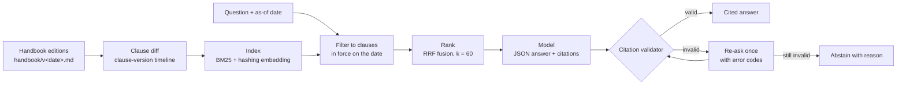

# asofrag

[](https://github.com/SlateGitOrg/asofrag/actions/workflows/ci.yml)


asofrag answers HR policy questions as of a date. It turns a handbook revised several times a year into a clause-version timeline, keeps only the clause versions in force on the date of the event, ranks them with BM25 and a hashing embedding fused by reciprocal rank fusion, and checks every citation the model returns. The evaluation scores a citation to a superseded version as wrong even when its quote matches word for word, and runs the same questions through a naive, recency-boosted retriever to measure the difference. All data is synthetic, generated by `asofrag seed`.

## The problem

HR operations at a multi-state employer answer employee questions about leave, expenses and remote work from a handbook that is revised several times a year. Disputes turn on the rule in force on the date of the event. A standard RAG index ranks every version of a clause by similarity, and when two versions differ by one number they score almost the same, so production indexes break the tie toward the newest. A March leave question then gets answered from a policy that changed in June: the quote is verbatim, the citation looks valid, and the answer is wrong. Repealed policies keep being quoted too, and nothing measures how often.

## How it works



- `corpus.py` reads `handbook/v<YYYY-MM-DD>.md`. A heading anchor such as `{#LEAVE-3.2}` is the clause's stable id; clause text is normalised (NFKC, straight quotes, collapsed whitespace).
- `timeline.py` diffs consecutive editions. Changed text starts a new clause-version with `effective_from` and closes the previous one; a clause missing from a later edition is repealed and its last version is closed; a clause that moves section keeps one timeline. `in_force(as_of)` includes `effective_from` and excludes `effective_to`.
- `index.py` has BM25 written from scratch (k1 = 1.2, b = 0.75), a numpy hashing embedding (character 3-5-grams, 2^14 signed buckets, l2-normalised) and reciprocal rank fusion.
- `retrieve.py` has two modes. `asof` filters to versions in force on the date before ranking. `naive` ranks every version with no date filter, then treats hits whose BM25 score and embedding cosine are both within 2% of the leader's as tied and puts the newest first. The tie test uses those pre-fusion similarity scores, not the fused RRF value, which only reflects rank positions.
- `dates.py` resolves the date: `--as-of`, then a date in the question (`2025-03-12`, `12 March 2025`, `March 12, 2025`), then a reference date.
- `answer.py` builds the prompt (context blocks labelled like `[LEAVE-3.2@2024-01-01]`), parses the JSON reply with pydantic and validates each citation in order: `CITATION_OUT_OF_FORCE`, `CITATION_NOT_RETRIEVED`, `QUOTE_NOT_FOUND`. It re-asks once with the codes, then abstains.
- `model.py` has `ExtractiveModel` (a deterministic offline reader), `FaultInjector` (replays `evals/faults.yaml`) and `OpenAICompatModel`.
- `evaluate.py` runs both modes and writes `reports/ablation.md` and `reports/ablation.json`.

## Quick start

```bash
uv venv --python 3.12 .venv
uv pip install --python .venv/bin/python -e ".[dev]"

.venv/bin/asofrag seed                      # handbook/, evals/ (already committed for seed 7)
.venv/bin/asofrag timeline LEAVE-3.2
.venv/bin/asofrag ask "On 12 March 2025, how many weeks of paid parental leave follow the birth or adoption of a child?"
.venv/bin/asofrag ask --mode naive "On 12 March 2025, how many weeks of paid parental leave follow the birth or adoption of a child?"
.venv/bin/asofrag eval                      # writes reports/ablation.md and reports/ablation.json
```

To use a real model instead of the offline reader, set `ASOFRAG_LLM_BASE_URL`, `ASOFRAG_LLM_API_KEY` and `ASOFRAG_LLM_MODEL` for any OpenAI-compatible chat-completions endpoint and pass `--model openai` to `ask`. `--reference-date` (or `ASOFRAG_REFERENCE_DATE`) sets the date used when a question has none; the default is 2026-01-01.

## Example output

The synthetic handbook has five editions (2024-01-01, 2024-07-01, 2025-01-01, 2025-06-01, 2026-01-01) of about 60 clauses in 8 sections. Between them it injects 14 amended values, 4 repealed clauses, 5 introduced clauses and 2 clauses that move section. `evals/questions.yaml` holds 60 questions with as-of dates, and `evals/faults.yaml` plans 7 first-attempt failures.

`asofrag eval` (full report in `reports/ablation.md`):

| mode | recall@3 | out-of-force citation rate | quote groundedness | answer accuracy | abstention accuracy |
|---|---|---|---|---|---|
| naive | 100.0% | 60.0% | 100.0% | 50.0% | 40.0% |
| as-of | 100.0% | 0.0% | 100.0% | 100.0% | 98.3% |

| count | naive | as-of |
|---|---|---|
| before-change questions citing the newer (out-of-force) version | 24 of 24 | 0 of 24 |
| abstentions on the 12 abstain questions | 0 of 12 | 11 of 12 |
| abstentions on the 48 answerable questions | 0 of 48 | 0 of 48 |
| unchanged-clause questions with gold in top 3 | 16 of 16 | 16 of 16 |

Groundedness is 100% in both modes by construction: the validator rejects quotes that are not verbatim and the offline reader only quotes real sentences, so this is not a finding about the retriever. What it does show is that a verbatim quote says nothing about whether the clause applied; the out-of-force column is the separate measurement. (A citation of a clause-version that does not exist counts as ungrounded.) The one as-of miss is Q51 ("On 25 January 2026, do employees get time off on their work anniversary?", gold: abstain), a question about a repealed anniversary half day: the offline reader's overlap threshold is crossed by an unrelated clause on "work" and "off", so it answers instead of abstaining. The validator caught all 7 planned faults on the first attempt (3 `QUOTE_NOT_FOUND`, 2 `CITATION_NOT_RETRIEVED`, 2 `CITATION_OUT_OF_FORCE`) and each question was answered correctly after the re-ask.

`asofrag timeline LEAVE-3.2`:

```
LEAVE-3.2  Parental leave
  v1  2024-01-01 -> 2025-06-01
      Employees receive 12 weeks of paid parental leave after the birth or adoption of a child. The leave may be taken in one block or in two blocks within the first year.
  v2  2025-06-01 -> (no end)
      diff vs v1: Employees receive [-12-] {+16+} weeks of paid parental leave after the birth or adoption of a child. The leave may be taken in one block or in two blocks within the first year.
```

`asofrag ask` for a March 2025 question:

```
as-of date: 2025-03-12 (question)
mode: asof
answer: Employees receive 12 weeks of paid parental leave after the birth or adoption of a child.
citation: [LEAVE-3.2@2024-01-01] "Employees receive 12 weeks of paid parental leave after the birth or adoption of a child."
attempts: 1
```

The same question with `--mode naive` cites `LEAVE-3.2@2025-06-01` and answers 16 weeks, a rule that did not exist until June.

## Design decisions

- **Filter before ranking, not after.** Filtering the candidates to clauses in force removes superseded versions from the context entirely, so the model cannot cite them. Re-ranking or post-filtering would leave a top-k with holes. The cost is that retrieval needs a date; a question with none falls back to a reference date, which is stated in the output.
- **Collection statistics stay global.** BM25 idf and average length are computed over every clause-version, so a version's score does not depend on which other versions the date filter removed. A filtered corpus would have simpler statistics but scores that shift with the date.
- **Groundedness and temporal correctness are separate metrics.** A citation can be verbatim and out of force. The validator checks time first, then retrieval, then the quote, and the evaluation reports the two failure kinds separately.
- **The naive ablation is a whole conventional pipeline.** It has no date filter, no date in the prompt and no temporal citation check; only the grounding checks remain. Keeping the temporal check would turn its out-of-force answers into abstentions and hide the failure being measured.
- **An offline extractive reader instead of a stub.** It picks the context block with the highest overlap of question content words and abstains below 0.35 coverage, so the results are reproducible and the retrieval and validation logic is exercised without a network. The trade-off is that it is a weak reader: it cannot reason about dates itself and it can be fooled by shared generic words, as in Q51 (the repealed anniversary half day, asked as of 25 January 2026).
- **The naive figures depend on the reader as well as the retriever.** The extractive reader keeps the first context block when two blocks overlap equally, and naive mode puts the newest of two near-identical versions first, so the 60.0% out-of-force rate and the 24 of 24 before-change count measure that combination. A reader that chose between two nearly identical versions some other way would score differently.
- **Hashing embeddings, no model download.** Character n-gram hashing needs no vocabulary or training and makes two clause versions that differ by one number almost identical, which is the hard case. It captures spelling overlap, not meaning.

## Testing

```bash
.venv/bin/python -m pytest -q
```

The suite runs offline. It covers the timeline (including the `in_force` boundary and a clause that returns after a repeal), BM25 against hand-computed values to 1e-9, RRF order, date resolution, the validator's code order, the re-ask loop, the OpenAI-compatible client against a mock transport, the end-to-end acceptance numbers above, byte-identical regeneration for a given seed, and that the committed sample data and reports match a fresh run. The live-model test is skipped unless `ASOFRAG_LIVE=1`.

## Project layout

```
src/asofrag/
  corpus.py      handbook loading and clause normalisation
  timeline.py    clause-version timeline, in_force, word diff
  index.py       BM25, hashing embedding, reciprocal rank fusion
  retrieve.py    as-of and naive retrieval modes
  dates.py       as-of date resolution
  answer.py      prompt, JSON schema, citation validator, re-ask loop
  model.py       extractive reader, fault injector, OpenAI-compatible client
  evaluate.py    metrics, ablation, fault plan, reports
  seeddata.py    the synthetic clause catalog and injected changes
  seed.py        seeded generator for editions, questions and faults
  cli.py         seed | timeline | ask | eval
handbook/        five synthetic editions (seed 7)
evals/           questions.yaml, faults.yaml
reports/         ablation.md, ablation.json
tests/
```

## License

MIT
